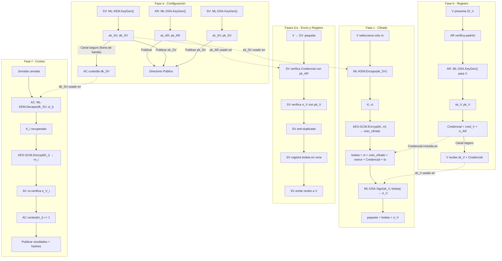

# Diagrama de Flujo — Protocolo de Votación Electrónica PQC
**Tesis:** *"Protocolo para la votación electrónica basado en criptografía post-cuántica de retículos"*  
**Versión:** 1.0 — Fase 1 (Diseño formal)  
**Fecha:** 2026-08-26  

---

## 1. Notación Alice-Bob (tarea 1.3)

La notación Alice-Bob describe el intercambio de mensajes entre los cuatro roles del protocolo.  
Se usa la siguiente convención:

```
A → B : M          -- A envía el mensaje M a B
{M}pk              -- M cifrado con la clave pública pk
[M]sk              -- M firmado con la clave privada sk
(K, ct) ← f(pk)   -- generación de secreto compartido K y ciphertext ct
```

---

### Fase (a) — Configuración (Setup)

```
-- Autoridad de Registro genera par ML-DSA --
AR:  (sk_AR, pk_AR) ← ML-DSA.KeyGen()

-- Servidor de Votación genera par ML-KEM + par ML-DSA --
SV:  (ek_SV, dk_SV) ← ML-KEM.KeyGen()
SV:  (sk_SV, pk_SV) ← ML-DSA.KeyGen()

-- Autoridad de Conteo recibe dk_SV por canal seguro fuera de banda --
SV →(seguro)→ AC : dk_SV

-- Publicación del directorio de claves públicas --
AR, SV → Directorio : (pk_AR, ek_SV, pk_SV)
```

---

### Fase (b) — Registro del Votante

```
-- V se presenta ante AR con su identidad --
V → AR : ID_V

-- AR verifica identidad y genera claves del votante --
AR:  (sk_V, pk_V) ← ML-DSA.KeyGen()
AR:  cred_V       := (ID_V || pk_V || ts)
AR:  σ_AR         := ML-DSA.Sign(sk_AR, cred_V)
AR:  Credencial   := (cred_V, σ_AR)
AR:  padron[ID_V] := (pk_V, "Registrado")

-- AR entrega credenciales al votante por canal seguro --
AR →(seguro)→ V : (sk_V, Credencial)
```

---

### Fase (c) — Cifrado del voto y firma de la boleta

```
-- V selecciona su candidato y lo codifica --
V:  m := encode(voto)

-- V encapsula para obtener K efímero --
V:  (K, ct) ← ML-KEM.Encaps(ek_SV)

-- V cifra el voto con K --
V:  nonce        := random_bytes(12)
V:  voto_cifrado := AES-256-GCM.Encrypt(K, m, nonce)

-- V construye la boleta --
V:  boleta := (ct || voto_cifrado || nonce || Credencial || ts_boleta)

-- V firma la boleta --
V:  σ_V    := ML-DSA.Sign(sk_V, boleta)

-- V construye el paquete final --
V:  paquete := (boleta, σ_V)
```

---

### Fase (d) — Envío y verificación

```
-- V envía el paquete al SV --
V → SV : paquete = (boleta, σ_V)

-- SV extrae y verifica --
SV:  (cred_V, σ_AR) := extraer_credencial(boleta)
SV:  assert ML-DSA.Verify(pk_AR, cred_V, σ_AR)   -- credencial válida
SV:  pk_V := extraer_pk_V(cred_V)
SV:  assert ML-DSA.Verify(pk_V, boleta, σ_V)      -- firma del votante válida
SV:  ID_V := extraer_ID(cred_V)
SV:  assert padron[ID_V].estado != "Ya votó"       -- anti-duplicado
SV:  → (si todo ok) continuar a fase (e)
SV:  → (si algún assert falla) rechazar paquete
```

---

### Fase (e) — Registro del voto cifrado

```
-- SV registra el voto y actualiza el padrón --
SV:  urna[ID_V]         := boleta
SV:  padron[ID_V].estado := "Ya votó"

-- SV emite recibo al votante --
SV:  ts_recibo   := now()
SV:  hash_boleta := SHA3-256(boleta || ts_recibo)
SV:  σ_recibo    := ML-DSA.Sign(sk_SV, (hash_boleta || ts_recibo))
SV:  recibo      := (hash_boleta, ts_recibo, σ_recibo)

-- SV entrega recibo a V --
SV → V : recibo
```

---

### Fase (f) — Desencapsulamiento y conteo final

```
-- (Jornada cerrada) SV entrega la urna a AC por canal seguro --
SV →(seguro)→ AC : {urna}

-- AC procesa cada boleta --
para cada boleta_i en urna:
    AC:  ct_i           := extraer_ct(boleta_i)
    AC:  K_i            ← ML-KEM.Decaps(dk_SV, ct_i)
    AC:  m_i            := AES-256-GCM.Decrypt(K_i, voto_cifrado_i, nonce_i)
    
    -- AC re-verifica integridad (correspondencia voto emitido / contabilizado) --
    AC:  (cred_V_i, σ_AR_i) := extraer_credencial(boleta_i)
    AC:  assert ML-DSA.Verify(pk_AR, cred_V_i, σ_AR_i)
    AC:  pk_V_i := extraer_pk_V(cred_V_i)
    AC:  σ_V_i  := extraer_firma_V(boleta_i_paquete)
    AC:  assert ML-DSA.Verify(pk_V_i, boleta_i, σ_V_i)
    
    -- AC contabiliza --
    AC:  conteo[m_i] += 1

-- AC publica resultados y hashes para auditoría --
AC → Público : (conteo, {SHA3-256(boleta_i) : i ∈ urna})
```

---

## 2. Diagrama de secuencia (Mermaid)

```mermaid
sequenceDiagram
    participant V as Votante (V)
    participant AR as Autoridad de Registro (AR)
    participant SV as Servidor de Votación (SV)
    participant AC as Autoridad de Conteo (AC)
    participant DIR as Directorio Público

    rect rgb(30, 40, 80)
        Note over AR,AC: FASE (a) — Configuración
        AR->>AR: (sk_AR, pk_AR) ← ML-DSA.KeyGen()
        SV->>SV: (ek_SV, dk_SV) ← ML-KEM.KeyGen()
        SV->>SV: (sk_SV, pk_SV) ← ML-DSA.KeyGen()
        SV-->>AC: dk_SV (canal seguro fuera de banda)
        AR->>DIR: Publicar pk_AR
        SV->>DIR: Publicar ek_SV, pk_SV
    end

    rect rgb(30, 70, 50)
        Note over V,AR: FASE (b) — Registro del Votante
        V->>AR: ID_V (identificación)
        AR->>AR: Verifica identidad en padrón
        AR->>AR: (sk_V, pk_V) ← ML-DSA.KeyGen()
        AR->>AR: cred_V = (ID_V ∥ pk_V ∥ ts)
        AR->>AR: σ_AR = ML-DSA.Sign(sk_AR, cred_V)
        AR-->>V: (sk_V, Credencial) [canal seguro]
    end

    rect rgb(70, 40, 30)
        Note over V,V: FASE (c) — Cifrado y firma del voto
        V->>DIR: Obtiene ek_SV
        V->>V: m = encode(voto_seleccionado)
        V->>V: (K, ct) ← ML-KEM.Encaps(ek_SV)
        V->>V: voto_cifrado = AES-256-GCM.Encrypt(K, m, nonce)
        V->>V: boleta = (ct ∥ voto_cifrado ∥ nonce ∥ Credencial ∥ ts)
        V->>V: σ_V = ML-DSA.Sign(sk_V, boleta)
        V->>V: paquete = (boleta, σ_V)
    end

    rect rgb(60, 30, 70)
        Note over V,SV: FASE (d) — Envío y verificación
        V->>SV: paquete = (boleta, σ_V)
        SV->>DIR: Obtiene pk_AR
        SV->>SV: Verifica credencial: ML-DSA.Verify(pk_AR, cred_V, σ_AR) ✓
        SV->>SV: Verifica firma votante: ML-DSA.Verify(pk_V, boleta, σ_V) ✓
        SV->>SV: Verifica anti-duplicado: ID_V no ha votado ✓
    end

    rect rgb(50, 50, 30)
        Note over SV,V: FASE (e) — Registro del voto cifrado
        SV->>SV: urna[ID_V] = boleta
        SV->>SV: padron[ID_V].estado = "Ya votó"
        SV->>SV: recibo = (SHA3-256(boleta ∥ ts), σ_SV)
        SV-->>V: recibo (comprobante)
    end

    rect rgb(20, 60, 60)
        Note over AC,SV: FASE (f) — Desencapsulamiento y conteo (jornada cerrada)
        SV-->>AC: {urna} [canal seguro]
        loop Para cada boleta_i en urna
            AC->>AC: K_i ← ML-KEM.Decaps(dk_SV, ct_i)
            AC->>AC: m_i = AES-256-GCM.Decrypt(K_i, voto_cifrado_i)
            AC->>AC: Re-verifica σ_V_i sobre boleta_i ✓
            AC->>AC: conteo[m_i] += 1
        end
        AC->>DIR: Publicar (conteo, {hash(boleta_i)})
    end
```



---

## 3. Diagrama de roles y flujo de claves



---

## 4. Propiedades verificadas en el flujo

| Fase | Propiedad garantizada | Mecanismo criptográfico |
|------|-----------------------|------------------------|
| (a) | Configuración segura de claves | ML-DSA.KeyGen + ML-KEM.KeyGen |
| (b) | Autenticidad de credenciales | ML-DSA.Sign(sk_AR, cred_V) |
| (c) | **Confidencialidad del voto** | ML-KEM.Encaps + AES-256-GCM |
| (c) | Vinculación voto-votante | ML-DSA.Sign(sk_V, boleta) |
| (d) | **Autenticidad votante–autoridad** | ML-DSA.Verify (doble verificación) |
| (d) | Unicidad (anti-replay, anti-duplicado) | Control de estado + ts_boleta + nonce |
| (e) | No-repudio del registro | Recibo firmado por SV |
| (f) | **Integridad voto emitido / contabilizado** | Re-verificación ML-DSA + hash auditoría |

---

## 5. Comparación PQC vs. Clásico (estructura del protocolo)

El protocolo clásico (Fase 4 del plan) replica exactamente la misma estructura, substituyendo únicamente la capa criptográfica:

| Operación | Protocolo PQC (ML-KEM/ML-DSA) | Protocolo Clásico (RSA/ECDSA) |
|-----------|-------------------------------|-------------------------------|
| Generación de claves | ML-KEM.KeyGen / ML-DSA.KeyGen | RSA-OAEP KeyGen / ECDSA KeyGen |
| Encapsulamiento/Cifrado | ML-KEM.Encaps + AES-256-GCM | RSA-OAEP.Encrypt |
| Firma | ML-DSA.Sign | ECDSA.Sign (P-256) |
| Verificación | ML-DSA.Verify | ECDSA.Verify |
| Desencapsulamiento/Descifrado | ML-KEM.Decaps + AES-256-GCM | RSA-OAEP.Decrypt |
| Resistencia cuántica | ✅ Sí (MLWE hardness) | ❌ No (Shor rompe RSA/ECDSA) |

---

*Entregable de la Fase 1. Ver también: [`arquitectura.md`](./arquitectura.md)*
